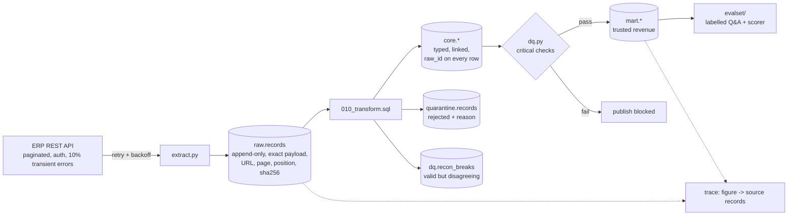

# ERP data pipeline with lineage, quality gates and an evaluation set

A small, complete data-engineering project: pull messy ERP-style data over a REST API, land it
untouched, clean it into a linked core model, reconcile it across systems, publish trusted
reporting tables, and build a labelled evaluation dataset on top, with every figure traceable
back to the exact API response that produced it.

> **Scope, honestly stated.** This is a personal project. The ERP is a *simulated* API (Flask)
> serving deterministic synthetic data with defects injected on purpose, so the quality checks
> can be tested against ground truth. It is not production experience and nothing here ran at
> enterprise scale (about 21,000 source records).

## Architecture



## Run it

Needs Python 3.11+, Flask and requests (`pip install -r requirements.txt`), and a reachable
Postgres 16 with the `psql` client. Connection comes from the usual `PGHOST`, `PGPORT`,
`PGUSER`, `PGDATABASE` variables.

```bash
make erp            # terminal 1: simulated ERP on :8081
make run            # terminal 2: extract -> raw -> core -> quality gate -> mart
make dq             # data quality report
make trace          # trace a monthly revenue figure back to source records
make eval           # build the eval set, score the reference answerers
make test           # 26 tests (needs Postgres; creates its own test database)
```

`docker-compose.yml` is included but was **not run** where this was built (no Docker daemon);
the commands above are the tested path.

## What it guarantees

**Lineage.** Every `core` row carries a `raw_id`. Every `raw.records` row stores the exact request
URL that returned it, the page, the position in that page, the extraction time and a SHA-256 of
the canonical payload. A trace re-adds the source records behind a reported number and checks it
ties out; hashes are re-verified so tampering with a stored payload is detected.

```
$ python -m pipeline.cli trace --month 2025-01
Trusted revenue 2025-01: 583,150.00 from 171 invoices
Sum of traced source records:   583,150.00   ties out: True
  INV-000001   3500.00  raw_id=171  http://.../api/invoices?page=1&page_size=200  position=50  sha256=be7297413d91
```

**Nothing is silently dropped.** Every raw record ends up in `core` or in `quarantine` with a
reason, and a test asserts `core + quarantined = raw` per entity.

**Two kinds of bad data, handled differently.**
- *Structurally invalid* (no customer, unknown customer, negative total, future-dated, duplicate
  id, orphan ledger line) is quarantined.
- *Valid but disagreeing* (invoice header vs sum of lines vs ledger) stays in `core`, gets a row
  in `dq.recon_breaks`, and is excluded from "trusted" revenue. The mart reports trusted and
  unreconciled amounts side by side; they add up to the core total (tested).

**A circuit breaker.** Critical checks (completeness against the API's own totals, payload hash
integrity, lineage present on every row, quarantine rate under 5%, core invariants) block
publishing the mart when they fail. A test shows an incomplete extraction is caught.

## Defects injected vs found

| Defect (injected on purpose) | Injected | Found | Handling |
|---|---:|---:|---|
| Invoice with no customer | 12 | 12 | quarantined |
| Invoice for unknown customer | 9 | 9 | quarantined |
| Negative invoice total | 6 | 6 | quarantined |
| Invoice dated after the ERP's as-of date | 5 | 5 | quarantined |
| Same invoice id returned twice | 8 | 8 | extra copy quarantined |
| Ledger lines for invoices that never existed | 7 | 7 | quarantined |
| Currency casing (`usd`, `Usd`) | 20 | 20 | normalised to `USD` |
| Header total differs from sum of lines | 15 | 15 | flagged, kept, not trusted |
| Ledger debits not equal to credits | 10 | 9 | flagged, kept, not trusted |

The ledger row is 9, not 10, because one of the ten invoices was already quarantined for another
defect and never reached core. The test compares against the manifest with that taken into account.

## Evaluation set

`evalset/build_eval.py` builds 84 labelled questions from the published mart, each with the SQL
that produced its answer. Categories: monthly revenue, invoice counts, region by quarter, top
customer, open balances, quarantine counts, reconciliation, unreconciled revenue, and lineage
("which API page returned INV-...?"). A deterministic dev/test split is included.
`evalset/score.py` scores any answers file (`{"id": ..., "answer": ...}` per line), so it can
grade a RAG or text-to-SQL system.

| Answerer | Accuracy |
|---|---:|
| Oracle (reads the labels; validates the scorer) | 100.0% |
| Naive query on the raw extract (no dedupe, quarantine, reconciliation or lineage) | 22.6% |
| Answers nothing | 0.0% |

The naive row is the point: querying the raw data directly gets monthly revenue wrong in all 18
months and cannot answer any data-quality or lineage question.

## Design decisions

- **Full refresh of `core` from one raw load** instead of incremental merges. Simpler to reason
  about and idempotent (tested). The cost is reprocessing everything each run, fine at this size.
  The API already supports paging; incremental extraction by `updated_since` is the next step.
- **Quarantine versus flag.** Records that cannot be linked are rejected; records that merely
  disagree are kept and labelled, because dropping real revenue is its own data-quality failure.
- **`psql` as the database layer.** Keeps dependencies to Flask and requests and uses `\copy` for
  bulk loads. Swapping in psycopg only touches `pipeline/db.py`.
- **Quality rules live in SQL and `dq.py`,** each check has a severity, and results are persisted
  per load in `dq.check_results` so quality is queryable over time.

## Known limits and next steps

- Synthetic data and a simulated API; a real ERP (ERPNext or Odoo) would add auth flows, schema
  drift and rate limits this does not exercise.
- Single-process, no orchestrator. Scheduling with Airflow or cron and alerting on a blocked
  publish are the obvious additions.
- Reconciliation tolerance is a fixed 0.5 cent; real ledgers need currency and rounding rules.
- The evaluation set grades answers; it does not include an LLM answerer. The scorer is built to
  plug one in.

## Layout

```
erp_sim/     simulated ERP API and deterministic seed data (with a defect manifest)
pipeline/    extract.py, ingest.py (raw landing), dq.py (checks), lineage.py (tracing), cli.py
sql/         001 schema, 010 transform + reconciliation, 020 mart
evalset/     build_eval.py, score.py, baselines.py
tests/       26 tests: injected defects vs found, lineage tie-out, tamper detection, idempotency, eval
```
